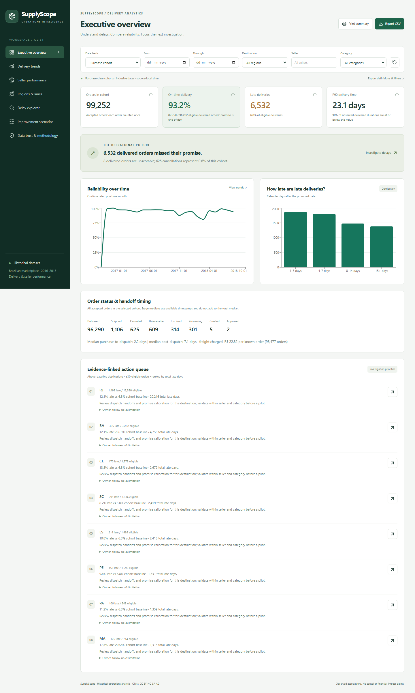
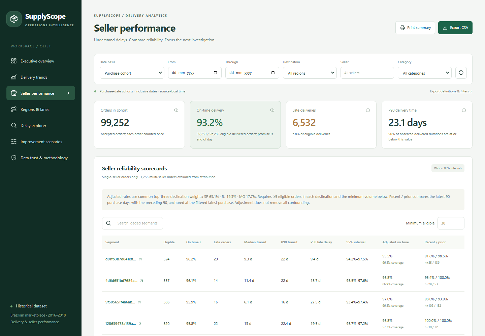
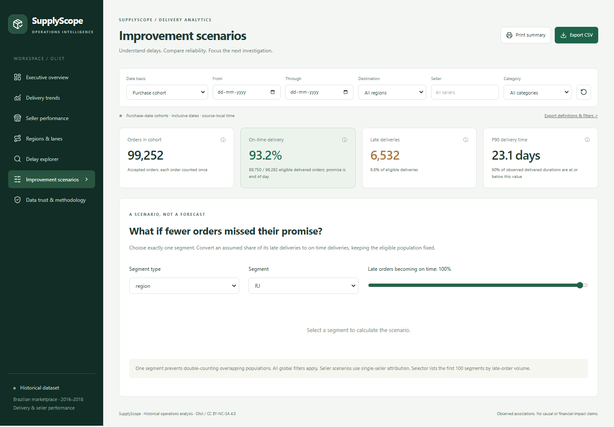

# SupplyScope — Delivery & Seller Performance Analysis

A reproducible, historical operations analytics portfolio project built in **D:\SupplyScope**. Python/pandas → DuckDB → FastAPI → React, plus a **Power BI build package**. Sellers are not verified suppliers; state pairs are not carrier routes.

## Findings from real data

99,252 accepted orders; 96,282 eligible deliveries; 93.22% on time; 6,532 late. Median transit 10.23 days, P90 23.11. RJ has 1,495 late / 12,330 eligible (12.12%), compared with 6.78% overall. These are historical descriptive findings, not realized business impact. Evidence and caveats: [executive report](reports/executive_findings.md), [reconciliation](reports/reconciliation.json).

## Setup — Windows PowerShell

All commands use the required project root. Python 3.11 and Node.js 20+ are prerequisites. No Docker, credentials, paid API or cloud account required.

    Set-Location D:\SupplyScope
    python -m venv D:\SupplyScope\.venv
    .\.venv\Scripts\python.exe -m pip install -r requirements.lock.txt
    npm.cmd ci --prefix frontend
    .\.venv\Scripts\python.exe -m pipelines.acquire
    .\.venv\Scripts\python.exe -m pipelines.build
    .\.venv\Scripts\python.exe -m pipelines.analyse
    .\.venv\Scripts\python.exe -m scripts.powerbi_package

Acquisition preserves existing raw files, pins the public mirror commit and verifies recorded SHA-256 digests. To import an official Kaggle download instead, place the seven unmodified CSVs in D:\SupplyScope\data\incoming, then run:

    .\.venv\Scripts\python.exe -m pipelines.acquire --local D:\SupplyScope\data\incoming

Do not mix mirrors or overwrite an existing manifest silently. Use a fresh raw directory only after archiving existing data within D:\SupplyScope. Data licence: **CC BY-NC-SA 4.0**, Olist and collaborators; attribution, noncommercial and share-alike obligations apply. Source and mirror URLs are in data/raw/manifest.json and docs/dataset.md.

## Run

Terminal 1:

    Set-Location D:\SupplyScope
    .\.venv\Scripts\python.exe -m uvicorn backend.app:app --host 127.0.0.1 --port 8000

Terminal 2:

    Set-Location D:\SupplyScope\frontend
    npm.cmd run dev

Open http://127.0.0.1:5173. API documentation: http://127.0.0.1:8000/docs. Health: /api/health. Stop terminals with Ctrl+C. Stop the API before rebuilding the warehouse on Windows because DuckDB locks an open database. A manually launched server from the implementation session can be stopped using scripts/stop-local.ps1, which verifies process command lines.

## Verify

    Set-Location D:\SupplyScope
    .\.venv\Scripts\python.exe -m pytest tests -q
    npm.cmd run build --prefix frontend
    $env:PLAYWRIGHT_BROWSERS_PATH='D:\SupplyScope\.cache\playwright'
    Set-Location D:\SupplyScope\frontend
    npx.cmd playwright install chromium
    npx.cmd playwright test

Browser tests automatically start and stop missing local servers, or reuse servers already running on the documented ports. They require the built warehouse, capture screenshots and write reports/ui-tests.json. Python synthetic fixtures live only in tests and never enter reports. The production build is frontend/dist; Vite proxies /api during local development. For a static deployment, configure an /api reverse proxy explicitly; no deployment is claimed.

To verify deterministic warehouse contents, stop the API and run `.\.venv\Scripts\python.exe -m scripts.check_idempotence` from the project root. This rebuilds the warehouse from preserved raw files and records table hashes in reports/idempotence.json.

## What to explore

- Seven pages: overview, trends, sellers, regions/lanes, delays, scenarios, trust.
- Purchase/delivery cohorts, URL-shareable date/region/seller/category filters.
- Order-grain metrics, Wilson intervals, sample-size flags, transparent adjustments and comparison coverage.
- Delay Pareto, promise buffer comparisons, variability, evidence-linked action queue.
- One-segment scenarios with an unchanged denominator; filtered order CSV and companion JSON metadata; printable current page.
- Sorting/search applies to each loaded 100-row scorecard page. The scenario selector offers the 100 largest loaded contributors.
- Category groups overlap and are not additive. Single-seller scorecards intentionally exclude multi-seller attribution.
- No overdue watchlist: the extraction/status snapshot is unknown.

## Deliverables

| Location | Contents |
|---|---|
| pipelines/ | Credential-free acquisition, validation/quarantine, warehouse and calculated reports |
| sql/ | Build, canonical aggregate contract and ten executable analytical questions (monthly and weekly separate) |
| backend/ | Parameterized read-only API; bounded pagination |
| frontend/ | React/TypeScript/Vite/Tailwind/Recharts dashboard and browser checks |
| data/raw/ | Original CSVs, source manifest, commit pin and checksums |
| data/staging/, data/quarantine/ | Typed staging and rejected rows with reasons |
| data/processed/ | Ten import-ready model tables |
| data/supplyscope.duckdb | Analytical warehouse |
| powerbi/ | Typed Power Query, 36 described DAX measures, theme, page designs, expected totals |
| reports/ | Actual SQL outputs, findings, action evidence, data quality and verification |
| docs/ | Architecture, capability matrix, metric/data dictionaries, screenshots and demo |

**Power BI Desktop validation is outstanding.** No PBIX/PBIP was fabricated. Follow [assembly instructions](powerbi/ASSEMBLY.md); DAX and M execution must be verified in Desktop before calling the report validated. Dynamic adjusted comparisons are implemented in the companion; the optional Power BI adjustment audit is explicitly static.

